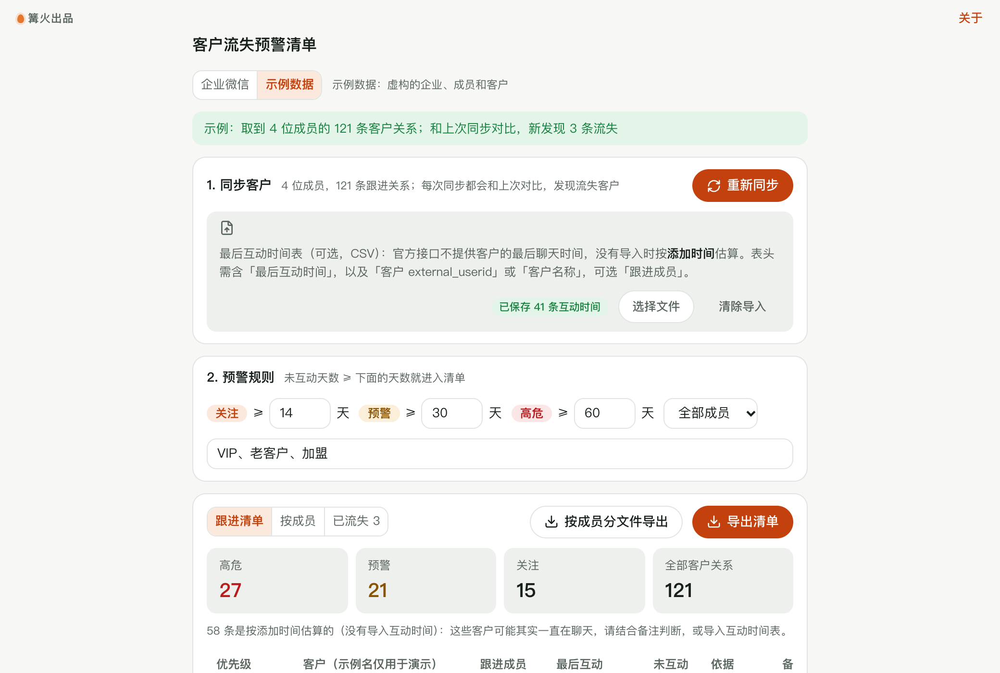

# 客户流失预警清单

> 篝火出品 · 收录于篝火 App 应用区

按最后互动时间生成跟进清单



## 下载

到 [Releases](https://github.com/campfire-code/wecom-churn-alert/releases/latest) 下载对应安装包：

| 电脑 | 文件 |
|---|---|
| Windows 10 / 11 | `wecom-churn-alert_版本号_windows-x64-setup.exe` |
| Mac（Apple 芯片） | `wecom-churn-alert_版本号_mac-arm64.dmg` |
| Mac（Intel 芯片） | `wecom-churn-alert_版本号_mac-x64.dmg` |

第一次打开：
- **Windows**：如果弹出「Windows 已保护你的电脑」，点「更多信息」→「仍要运行」。
- **Mac**：如果提示「无法验证开发者」，打开「系统设置 → 隐私与安全性」，在下方点「仍要打开」。

## 怎么用

先决条件：你要有企业微信的管理员权限，并在管理后台完成下面几步（接口要求，核对自企业微信开发者中心文档 path/92114、path/92132）：

1. 在「我的企业 → 企业信息」底部复制**企业 ID**。
2. 在「应用管理」里创建（或使用已有的）**自建应用**，复制它的 **Secret**。
3. 在「客户联系 → 客户 → 可调用接口的应用」里把这个自建应用加进去，否则会提示没有权限（错误码 48002 / 84074）。
4. 自建应用的**可见范围**要包含需要查看的成员，成员需要开通客户联系功能。
5. 在应用详情的「企业可信IP」里填本机所在网络的公网出口 IP（固定 IP），否则会报错误码 60020。
6. 2023 年 12 月 1 日起，新企业不能再用系统应用的 Secret 调用客户联系接口，请使用自建应用。

**先说清楚一个限制**：企业微信官方接口里**没有「客户最后聊天/互动时间」**（客户详情只有「添加时间」）。所以本工具这样算「未互动天数」：
- 你导入了某客户的最后互动时间（例如从自己的 CRM、会话存档系统、成员登记表导出的 CSV），就用导入的时间（只采用晚于添加时间的）；
- 没有导入的，用**添加时间**估算，清单的「依据」列会标明，这些客户可能其实一直在聊天，请结合备注判断。

操作：

1. 打开工具，在「企业微信设置」里填企业 ID 和 Secret，点「保存并测试连接」。二者只保存在本机设置里，不会上传，也不会写进日志。没有企业账号可以先切到「示例数据」体验。
2. 点「同步客户」：读取全部成员的客户跟进信息，并读取每位成员近 30 天的联系客户统计。
3. 可选：点「选择文件」（或把文件拖进窗口）导入最后互动时间表（CSV，用 Excel 另存为 CSV 即可）。表头要有「最后互动时间」，以及「客户 external_userid」或「客户名称」，可选「跟进成员」；日期支持 `2026-10-20`、`2026/10/20`、`2026年10月20日`、带时分秒、Unix 秒数、Excel 序列日期。客户名称重复又没写成员的行会跳过。导入结果会保存在本机，下次同步继续使用。
4. 在「预警规则」设置三档天数（默认关注 14 天、预警 30 天、高危 60 天，要求依次变大），可按成员筛选，可填重点客户关键词（备注或描述里含关键词的标「重点」，同天数排前面）。
5. 在「跟进清单」里点「高危 / 预警 / 关注」卡片筛选，点「导出清单」得到 CSV，或「按成员分文件导出」给每位成员发各自的清单。「按成员」页看每位成员的客户数、各档人数和近 30 天联系客户数。
6. 「已流失」页：官方接口不能直接查「客户删除了成员」，本工具把每次同步的结果存在本机，下次同步时对比，上次有、这次没有的客户列为流失（客户删了成员，或成员删了客户，两者无法区分）。第一次同步没有对比对象，所以要同步两次以上才能发现；成员已不在列表或没有互通账号许可的不算。

**未核实**：get_user_behavior_data 的「聊天客户数」等字段含义按官方文档字段名使用，没有用真实账号核对数值口径；本工具没有用真实企业账号测试过，接口格式按官方文档和测试里的应答样例验证。本工具不读取聊天内容，也不使用会话内容存档。

## 验收用例

以下全部用「示例数据」和 `samples/示例互动时间.csv` 完成，不需要企业微信账号，也不联网（示例日期按 2026 年 10 月下旬设计）：

1. 打开工具，顶部选「示例数据」，点「同步客户」。应提示取到 4 位成员的 65 条客户关系，并说明「这是第一次同步，下次同步起才能发现流失」；清单里出现高危/预警/关注客户，「依据」列都是「添加时间」，下方有「估算」提示。
2. 记下三张卡片的数字，点「选择文件」选 `samples/示例互动时间.csv`。应提示「导入 21 行：对上 20 行，没对上 1 行，1 行无法识别（第 23 行）」；清单里客户数明显减少（这 20 位客户最近有互动）。
3. 把「高危」改成 `20`、「预警」改成 `30`、「关注」改成 `30`：「天数要满足 关注 < 预警 < 高危」的红字提示出现，清单消失；改回默认值后恢复。
4. 点「高危」卡片：清单只剩高危客户，再点取消。选一位成员：清单只剩该成员的客户。
5. 点「导出清单」，用表格软件打开，应有 12 列：优先级、跟进成员、客户名称、客户企业名、备注、描述、添加时间、最后互动时间、未互动天数、时间依据、重点客户、客户 external_userid。
6. 点「按成员分文件导出」，导出文件夹里应有每位成员一份 `跟进清单-成员.csv`。
7. 再点一次「重新同步」，应提示「和上次对比，新发现 0 条流失」（示例数据没变）；「按成员」页能看到每位成员近 30 天聊天客户数。
8. 真实企业验收：按「怎么用」完成后台设置，切到「企业微信」，点「保存并测试连接」应提示「连接成功」；Secret 填错应提示「Secret 不对」。

## 自己编译

需要 Node.js 22、pnpm、Rust。

```bash
pnpm install
pnpm test          # 单元测试
pnpm tauri dev     # 开发运行
pnpm tauri build   # 打包
```

界面框架在 `src/kit`（所有 campfire-code 工具共用），本工具的逻辑在 `src/tool`。

## 归属

本工具由**篝火**出品，是篝火 App 应用区收录的开源工具之一，由篝火（GitHub 组织 [campfire-code](https://github.com/campfire-code)）维护与更新。全部工具的目录见 [toolkit-hub](https://github.com/campfire-code/toolkit-hub)。

## 许可证

MIT，版权方为篝火（campfire-code）。
